<div align="center">

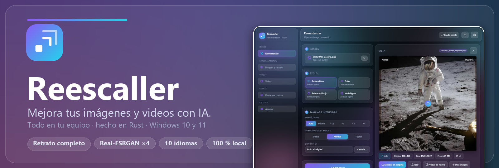

<br><br>

[](https://github.com/BryanZzzz1/Reescaller-App-/releases/latest)
[](#-roadmap)
[](LICENSE)


%20%7C%2011-0078d4?style=flat-square&logo=windows11&logoColor=white)


**[Qué hace](#-qué-hace) · [Resultados reales](#-resultados-reales) · [La aplicación](#-la-aplicación) · [Instalador](#-el-instalador) · [Pruebas](#-pruebas-realizadas) · [Instalación](#-instalación) · [Roadmap](#-roadmap) · [Compilar](#-compilar-desde-el-código-fuente)**

</div>

---

Reescaller es una aplicación de escritorio para Windows escrita en **Rust**. Reescala y mejora fotos con **Real-ESRGAN**, restaura retratos completos (rostro, pelo, ropa y fondo) con **GFPGAN / RestoreFormer++** ejecutados de forma nativa con ONNX Runtime, y procesa video fotograma a fotograma con **FFmpeg**. Todo ocurre en tu equipo: no se sube ninguna imagen a internet.

## ✨ Qué hace

| | |
|---|---|
| 🖼️ **Imágenes** | Escala libre de 0,25× a 8×, modos «siempre», «solo si hace falta» y «solo mejorar», mezcla de mejora 0–100 %, nitidez y peso de salida por calidad o por **tamaño objetivo en KB**. Respeta la orientación EXIF del móvil. |
| 🧑‍🚀 **Retrato completo** | Restaura el rostro y mejora también pelo, ropa y fondo. Amplía ×4 las fotos pequeñas, aclara las oscuras, permite ajustar la fuerza y trae un **comparador con deslizador y zoom**. |
| 🎞️ **Video** | Mejora fotograma a fotograma conservando el audio y el FPS originales; convierte a MP4, WebM, GIF o MP3. |
| 📁 **Carpetas** | Procesa lotes y guarda en una subcarpeta `Mejoradas` con el sufijo `_mejorado`. |
| 🪄 **Modo fácil y avanzado** | El fácil analiza la imagen y propone ajustes (Automático, Foto, Anime, Web ligera); el avanzado expone todos los parámetros. |
| 🎨 **Tu estilo** | Claro/oscuro, ocho paletas, tema propio con selector de color, fondo animado, icono por tema y **10 idiomas**. |
| 🖥️ **Compatibilidad** | Detecta CPU, RAM y GPU (NVIDIA GTX 600+, AMD RX 400+, Intel Arc), comprueba Vulkan y avisa si falta el driver. |
| 🔒 **Privado** | Sin nube ni telemetría propia. La app solo escucha en `127.0.0.1` con un token distinto en cada ejecución. |

## 🔬 Resultados reales

Ejecutados con la propia aplicación sobre fotos de la NASA (dominio público), reducidas y comprimidas a propósito. Equipo de pruebas: Intel Core i5-9600KF + AMD Radeon RX 6600 (8 GB), Windows 11.

### Retrato completo · 210 × 210 px (4 KB) → 840 × 840 px

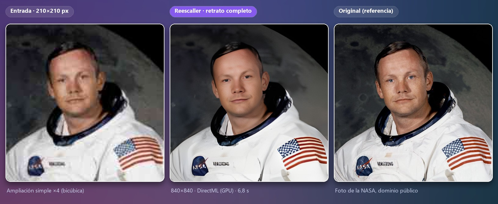

### Escena · 480 px → 1920 px (×4)

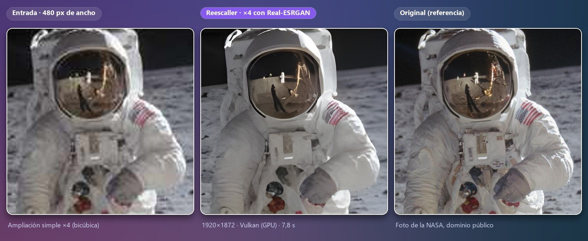

| Prueba | Entrada | Salida | Tiempo | Motor | Nitidez medida* |
|---|---|---|---|---|---|
| Retrato completo | 210×210 px, JPEG de 4 KB | 840×840 px | **6,8 s** | ONNX Runtime · DirectML (GPU) | ampliación simple **5** → **164** |
| Reescalado ×4 | 480×468 px | 1920×1872 px | **7,8 s** | Real-ESRGAN · Vulkan (GPU) | ampliación simple **10** → **212** |

<sub>\*Varianza del laplaciano (mide bordes y detalle fino, no fidelidad). **La IA reconstruye detalle plausible, no recupera datos que ya no existen**: por ejemplo, en el retrato el color de los ojos del resultado no coincide con el original, y las letras pequeñas del parche no se leen. Úsalo para mejorar fotos, no como prueba documental.</sub>

## 💻 La aplicación

<div align="center">

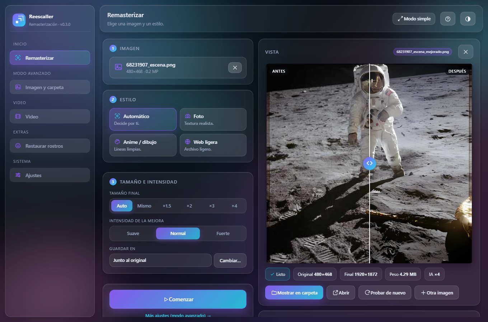

*Modo fácil: eliges imagen y estilo, y comparas antes y después con el deslizador.*

</div>

<table>
<tr>
<td width="50%">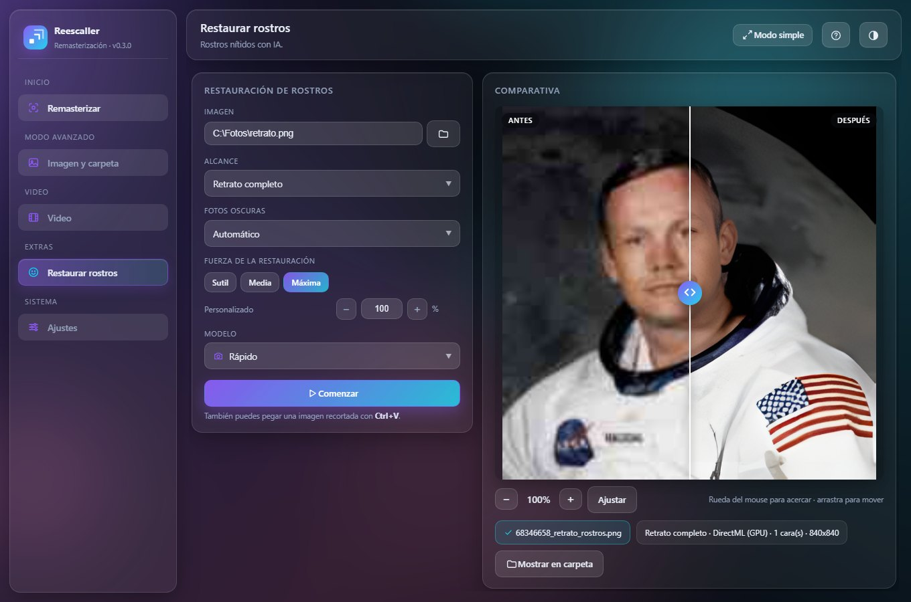<br><sub><b>Restaurar rostros.</b> Alcance, fotos oscuras, fuerza y modelo; comparador con zoom hasta ×8.</sub></td>
<td width="50%">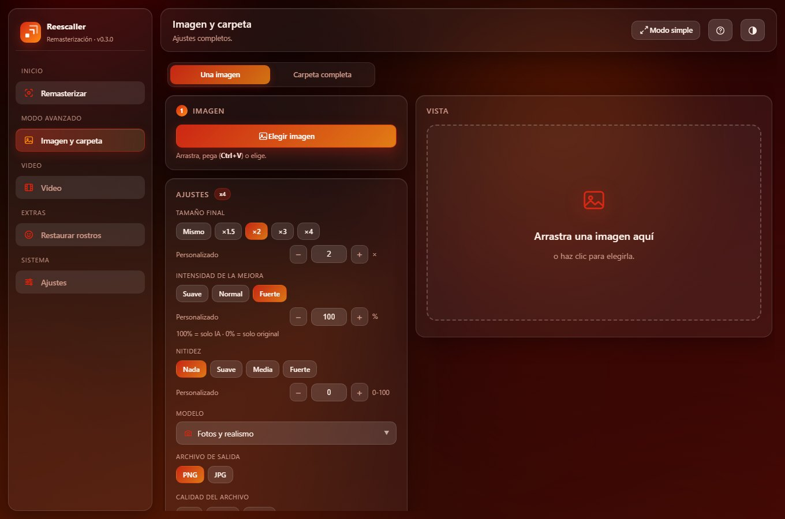<br><sub><b>Modo avanzado.</b> Escala, intensidad, nitidez, modelo, formato y calidad, con valores personalizados.</sub></td>
</tr>
<tr>
<td width="50%">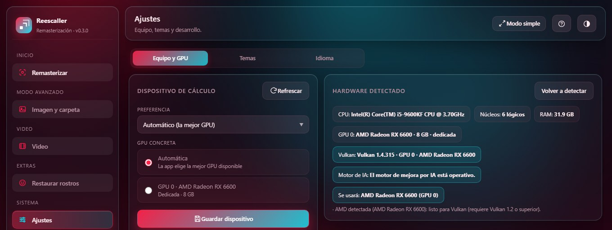<br><sub><b>Equipo y GPU.</b> Detección de hardware, Vulkan y compatibilidad de cada modelo.</sub></td>
<td width="50%">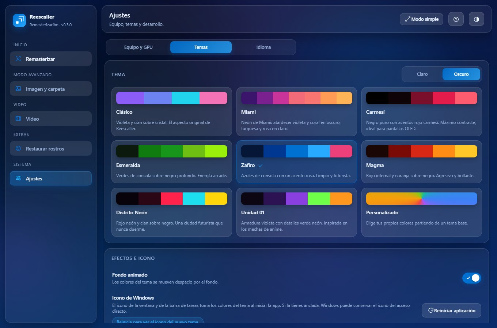<br><sub><b>Temas.</b> Ocho paletas, claro/oscuro, fondo animado y tema propio.</sub></td>
</tr>
</table>

<div align="center">

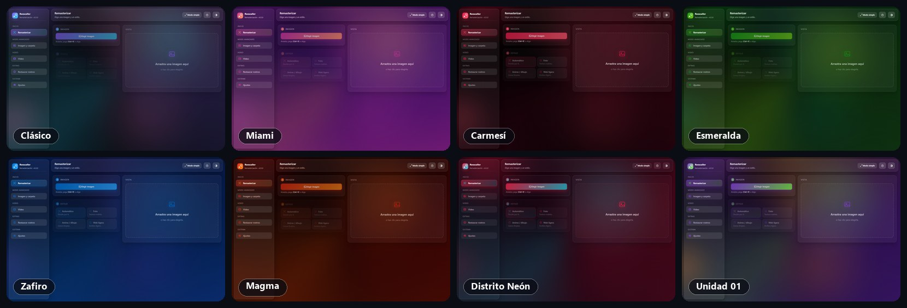

*Las ocho paletas: Clásico, Miami, Carmesí, Esmeralda, Zafiro, Magma, Distrito Neón y Unidad 01.*

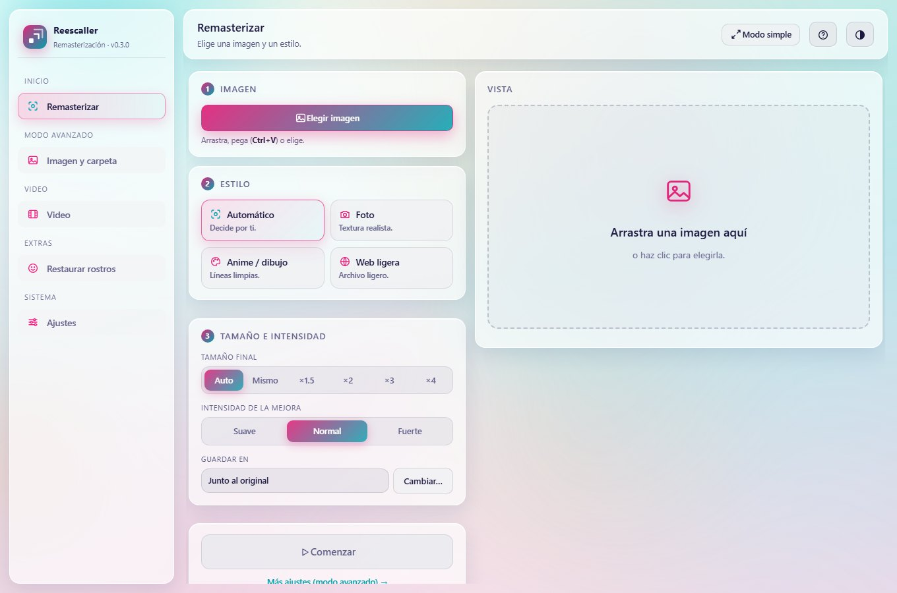

*Modo claro (Miami).*

</div>

## 📦 El instalador

Un instalador propio, con el mismo estilo que la app: una sola ventana, presentación de funciones mientras se instala y barra de progreso. Instala por usuario (sin pedir administrador) y trae su desinstalador.

<table>
<tr>
<td width="50%">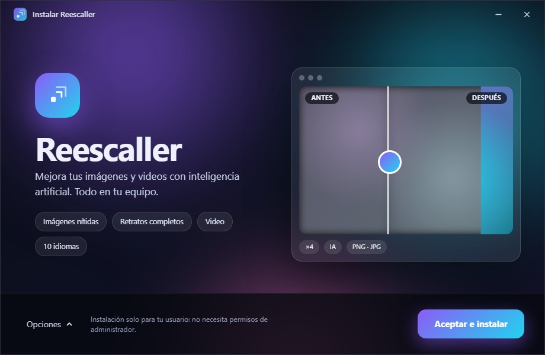<br><sub><b>1 · Bienvenida.</b> «Aceptar e instalar» u «Opciones».</sub></td>
<td width="50%">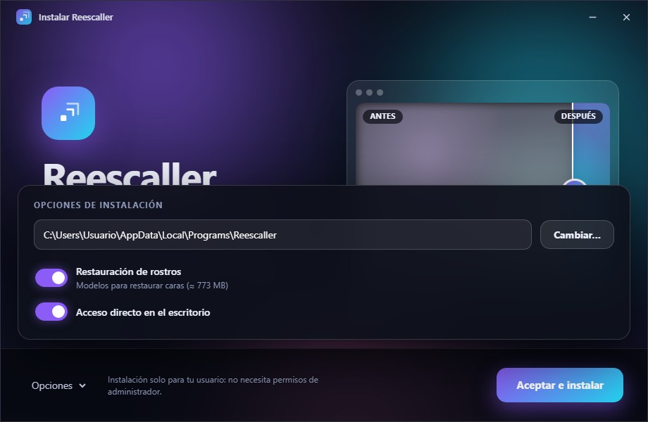<br><sub><b>2 · Opciones.</b> Carpeta, restauración de rostros (≈ 800 MB) y acceso directo.</sub></td>
</tr>
<tr>
<td width="50%">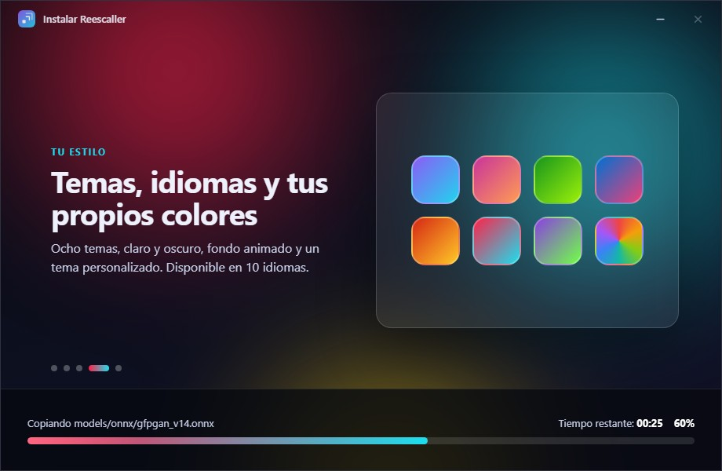<br><sub><b>3 · Instalando.</b> Funciones de la app, colores que cambian y barra con tiempo restante.</sub></td>
<td width="50%">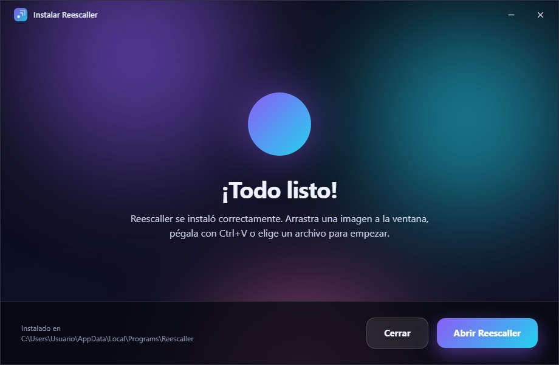<br><sub><b>4 · Listo.</b> La app no se abre sola: tú decides con «Abrir Reescaller».</sub></td>
</tr>
</table>

## 🧰 Tecnología

| Pieza | Para qué |
|---|---|
|  | Núcleo, CLI, servidor local, ventana e instalador (workspace de 5 crates). |
|  | Ventana propia sin marco con la interfaz web embebida (`wry` + `tao`). |
|  | Mejora de imágenes y video por GPU (NVIDIA, AMD, Intel). |
|  | Restauración de rostros (GFPGAN y RestoreFormer++) sin Python ni PyTorch. |
|  | Extraer, codificar y convertir video; audio y FPS originales. |

## ✅ Pruebas realizadas

Todo lo de esta tabla se ejecutó sobre el código y los binarios de esta versión.

| Qué | Resultado |
|---|---|
| **Tests unitarios** (`cargo test --workspace`) | ✅ 31 superados |
| **Verificador de entorno** (`reescaller-selftest`) | ✅ **30/30**: motores y modelos, hardware y Vulkan, escalas ×1,5 y «solo mejora», peso objetivo en KB, lote, video con FPS heredado y audio, modo fácil, respaldo sin GPU y servidor |
| **Análisis estático** (`cargo clippy --all-targets`, `cargo fmt`) | ✅ 0 avisos en el código de producción |
| **Retrato real** (NASA) | ✅ 210 px → 840 px en 6,8 s en GPU; rostro, pelo, ropa y fondo restaurados |
| **Escena real** (NASA) | ✅ 480 px → 1920 px en 7,8 s en GPU |
| **Video** (2 s, 320×240 @ 25 fps con audio) | ✅ 480×360 @ 25 fps, 50 fotogramas, audio conservado (42 s en total) |
| **Instalador, instalación silenciosa** | ✅ 999 MB copiados; los modelos coinciden por huella SHA-256 con los originales |
| **Instalador, desinstalación** | ✅ borra carpeta, entrada de «Aplicaciones instaladas» y accesos directos; código de salida 0 |
| **Instalador firmado (certificado de prueba)** | ✅ el instalador sigue funcionando con firma Authenticode y sello de tiempo |
| **Seguridad** | ✅ token por ejecución (`403` sin él), CSP, validación de rutas de subida, apertura de carpetas y configuración |
| **Hardware** | Probado en Intel Core i5-9600KF + AMD Radeon RX 6600. **NVIDIA, Intel Arc, gráficas híbridas y Windows 10 limpio aún sin probar** (ver roadmap). |

## 🚀 Instalación

1. Descarga **`Reescaller-0.3.0-Setup.exe`** desde la [última *release*](https://github.com/BryanZzzz1/Reescaller-App-/releases/latest).
2. Ejecútalo y pulsa **Aceptar e instalar**. En **Opciones** puedes cambiar la carpeta, omitir la restauración de rostros y decidir si se crea el acceso del escritorio.
3. Al terminar, pulsa **Abrir Reescaller**.

Se instala en `%LOCALAPPDATA%\Programs\Reescaller`, añade Microsoft Edge WebView2 Runtime si falta y se desinstala desde *Configuración → Aplicaciones instaladas*. También hay una versión **portable** (`Reescaller-0.3.0-win64.zip`): descomprime y ejecuta `Reescaller.exe`.

> ⚠️ El instalador **aún no está firmado**: Windows SmartScreen puede avisar. Pulsa «Más información» → «Ejecutar de todas formas».

Instalación silenciosa para scripts:

```bat
Reescaller-0.3.0-Setup.exe /S --dir="C:\Apps\Reescaller" [--no-faces] [--no-desktop]
"C:\Apps\Reescaller\Uninstall.exe" /S [--purge]
```

### Requisitos

| | Mínimo |
|---|---|
| Sistema | Windows 10 (1809) o Windows 11, 64 bits |
| Mejora por IA | GPU con **Vulkan** y driver actualizado: NVIDIA GTX 600+, AMD RX 400+ o Intel Arc |
| Espacio | ≈ 1 GB con restauración de rostros; ≈ 200 MB sin ella |

Sin GPU compatible la app funciona, pero sin la mejora por IA.

### Uso

- Arrastra una imagen a la ventana, pégala con `Ctrl+V` o elige un archivo.
- La configuración se guarda en `%APPDATA%\Reescaller\config.json`; los registros y la caché, en `%LOCALAPPDATA%\Reescaller\`.
- Línea de comandos (carpeta de la app):

```bat
reescaller-cli.exe doctor
reescaller-cli.exe upscale --input foto.jpg --target 1.5 --weight-quality 88
reescaller-cli.exe face --input retrato.jpg --output retrato_mejorado.png
reescaller-cli.exe batch --input entrada --output salida --target 2
```

## 🧭 Roadmap

Estado actual: **v0.3.0**. El detalle y las prioridades están en [`ROADMAP.md`](ROADMAP.md).

**✅ Hecho**
- [x] App de escritorio en Rust con interfaz propia, modo fácil y avanzado, temas y 10 idiomas
- [x] Retrato completo con ONNX (ampliación automática, fotos oscuras, fuerza ajustable, comparador con zoom)
- [x] Instalador propio con presentación de funciones y desinstalador
- [x] Auditoría de seguridad, licencias de terceros revisadas y mecanismo de firma de código
- [x] 31 tests unitarios, verificador 30/30 y 0 avisos de clippy

**🔧 v0.3.x · Estabilizar**
- [ ] Probar en NVIDIA, Intel Arc, gráficas híbridas y Windows 10 limpio
- [ ] Certificado de firma de código (SmartScreen)
- [ ] PNG con transparencia y nombres de salida que no se pisen en lotes
- [ ] Decidir el uso comercial de la restauración de rostros (licencias de los modelos)

**🎯 v0.4 · Calidad y comodidad**
- [ ] Cola de trabajos con pausa, cancelación y reanudación
- [ ] Edición básica de video (recortar clip)
- [ ] Actualizador integrado y menú contextual de Windows
- [ ] Más formatos: WebP, AVIF, TIFF

**🧪 v0.5 · Más motores**
- [ ] CodeFormer y GPEN-BFR; modelos para anime, texto y fotos antiguas
- [ ] Modo de difusión opcional (SUPIR, DiffBIR) para GPUs de 12 GB o más
- [ ] Reducir la descarga (cuantizar modelos, bajar los de rostros bajo demanda)

**🏁 v1.0 · Estable**
- [ ] Pruebas superadas en NVIDIA, AMD e Intel · ejecutables firmados · CI en GitHub Actions · guía de contribución

## 🔧 Compilar desde el código fuente

**Necesitas**: Rust 1.75+ con la toolchain `stable-x86_64-pc-windows-gnu` y [WinLibs MinGW](https://winlibs.com/) (`winget install BrechtSanders.WinLibs.POSIX.UCRT`). Opcional: Python 3 (empaquetado del instalador) e [Inno Setup 6](https://jrsoftware.org/isinfo.php) (instalador alternativo).

**Activos que no están en el repositorio** (carpeta `models/`, ≈ 800 MB, se distribuyen aparte): `realesrgan-ncnn-vulkan.exe`, `ffmpeg.exe` y `models/*.bin|*.param`. Para los rostros en ONNX, ejecuta `experimental/onnx-faces/export_onnx.py`.

> `rust/build.bat` contiene la ruta de WinLibs de la máquina del autor; ajusta la variable `MINGW` a tu instalación.

```bat
:: compilar todo
rust\build.bat build --release

:: comprobaciones
rust\build.bat test --workspace --release
probar.bat

:: carpeta portable + ZIP + instalador propio (+ Inno si está instalado)
powershell -ExecutionPolicy Bypass -File scripts\build_dist.ps1 -WithOnnx

:: paquete de código fuente y huellas SHA-256
powershell -ExecutionPolicy Bypass -File scripts\make_source.ps1
```

El resultado queda en `dist\`: `Reescaller\` (portable), `Reescaller-<ver>-win64.zip`, `Reescaller-<ver>-Setup.exe`, `Reescaller-<ver>-Setup-Inno.exe` y `Reescaller-<ver>-source.zip`. La firma de código es opcional (`scripts\sign.ps1`, variables `REESCALLER_SIGN_*`). Interfaz de depuración en el navegador (`http://127.0.0.1:7878`): `iniciar_debug.bat`.

### Estructura

```
rust/                         workspace de Cargo
  crates/reescaller-core/     dominio: escalado, mezcla, peso, lote, video, rostros, hardware
  crates/reescaller-cli/      línea de comandos (reescaller-cli.exe)
  crates/reescaller-app/      app de escritorio (Reescaller.exe) + servidor local + interfaz (index.html)
  crates/reescaller-selftest/ verificador de entorno
  crates/reescaller-setup/    instalador y desinstalador (lanzador + interfaz WebView2)
scripts/                      build_dist, build_setup, pack_setup, make_source, sign, gen_third_party
installer/                    instalador alternativo (Inno Setup) y sus imágenes
experimental/onnx-faces/      exportación de los modelos de rostros a ONNX
docs/                         auditoría, ruta de migración nativa e imágenes de este README
LICENSE · THIRD_PARTY_NOTICES.md · licenses/    licencia MIT y avisos de terceros
PROJECT.md · ROADMAP.md       bitácora técnica y próximos pasos
All.py, requirements.txt      aplicación original en Python (legado)
```

Documentación: [`PROJECT.md`](PROJECT.md) (arquitectura, decisiones y registro de cada ronda), [`docs/AUDITORIA.md`](docs/AUDITORIA.md), [`docs/RUTA_MIGRACION_NATIVA.md`](docs/RUTA_MIGRACION_NATIVA.md) y [`rust/README.md`](rust/README.md).

## ⚖️ Licencia y créditos

El código de Reescaller es **MIT** ([`LICENSE`](LICENSE)). La aplicación incluye programas y modelos de terceros con sus propias licencias; el detalle, los textos originales y el código fuente de FFmpeg están en [`THIRD_PARTY_NOTICES.md`](THIRD_PARTY_NOTICES.md) y en [`licenses/`](licenses/) (también se instalan junto a la app).

- **FFmpeg** va como programa independiente bajo **GPL v3** (build de gyan.dev). Cada *release* adjunta el código fuente de FFmpeg 8.0.
- **Restauración de rostros**: GFPGAN y RestoreFormer++ se entrenaron con FFHQ y GFPGAN incluye componentes de uso no comercial. Para uso personal no hay impedimento; para uso **comercial** consulta antes `THIRD_PARTY_NOTICES.md`. El instalador permite omitir ese componente.

Gracias a los proyectos en los que se apoya: [Real-ESRGAN](https://github.com/xinntao/Real-ESRGAN) y [Real-ESRGAN-ncnn-vulkan](https://github.com/xinntao/Real-ESRGAN-ncnn-vulkan), [GFPGAN](https://github.com/TencentARC/GFPGAN), [RestoreFormer++](https://github.com/wzhouxiff/RestoreFormerPlusPlus), [facexlib](https://github.com/xinntao/facexlib), [ONNX Runtime](https://github.com/microsoft/onnxruntime), [DirectML](https://github.com/microsoft/DirectML), [FFmpeg](https://ffmpeg.org) y [wry](https://github.com/tauri-apps/wry). Las fotos de ejemplo son de la NASA (dominio público).

## 🧪 Estado y contacto

Versión **0.3.0**, en pruebas. Limitaciones conocidas: el PNG de salida pierde el canal alfa, y en lotes `a.png` y `a.jpg` pueden generar el mismo nombre de salida. Si encuentras un problema, abre un *issue* con tu GPU, la versión de Windows y el resultado de `reescaller-cli.exe doctor`.

## 🐍 Código legado en Python

`All.py` es la aplicación original (CustomTkinter + PyTorch). Se conserva como referencia y no recibe novedades. Para ejecutarla: Python 3.10/3.11, `pip install -r requirements.txt`, `ffmpeg.exe`, `realesrgan-ncnn-vulkan.exe` y los pesos `GFPGANv1.4.pth` / `RestoreFormer++.ckpt` en `models/`, y luego `python All.py`.
